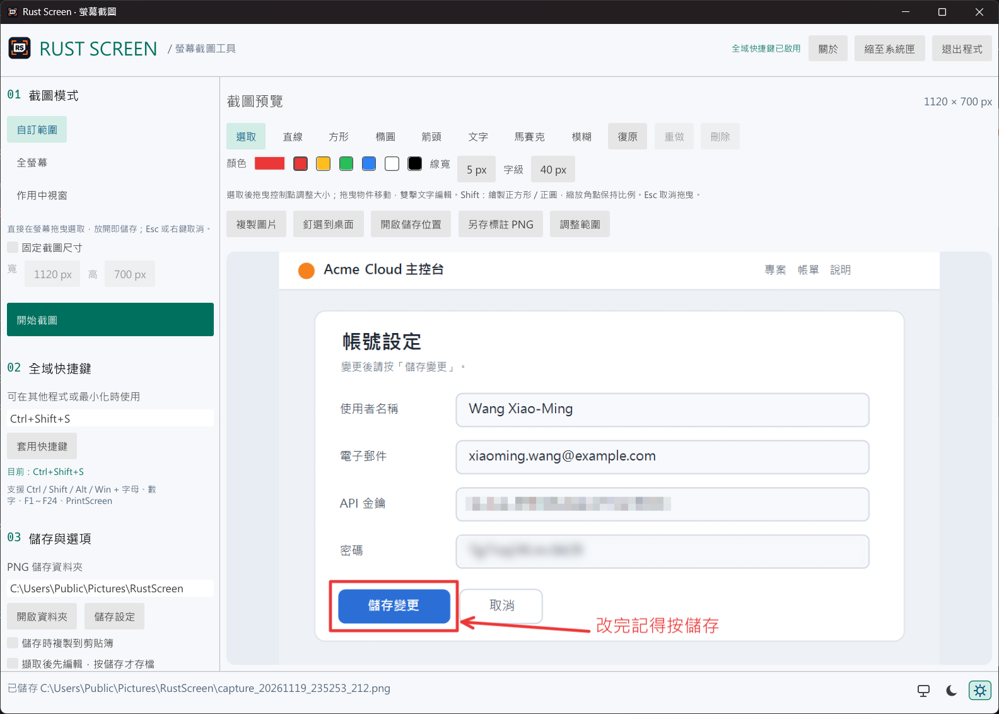
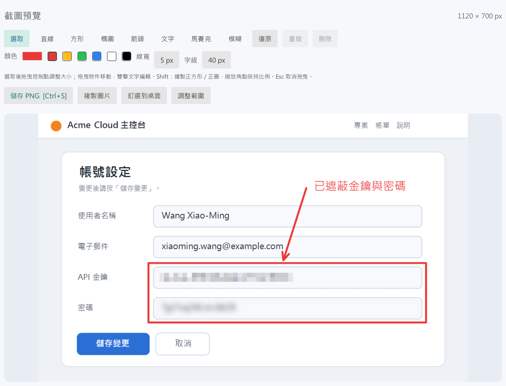

# Rust Screen

以 Rust 製作的 Windows 10 / 11 桌面截圖工具，介面使用 [egui / eframe](https://github.com/emilk/egui)，透過 Win32 GDI 擷取畫面。另附一個 MCP 伺服器，讓 Claude 等 AI 助理也能擷取畫面。

官網：<https://rust-screen.fujin365.cc/>

<picture>
  <source media="(prefers-color-scheme: dark)" srcset="docs/screenshot-main-dark.png">
  
</picture>

## 功能

- **全域快捷鍵**：預設 `Ctrl + Shift + S`，可自訂（例如 `Alt+F9`、`Ctrl+PrintScreen`）。
- **三種截圖模式**：自訂範圍（直接在螢幕拖曳選取，支援跨螢幕）、全螢幕、作用中視窗。
- **固定尺寸與再裁切**：可指定精確寬高；儲存後也能「調整範圍」再另存。
- **預覽標註**：直線、方形、橢圓、箭頭、繁體中文文字；支援選取、移動、縮放、改色、復原／重做。
- **馬賽克與模糊**：拖曳選取要遮蔽的區域，可調整格子大小／模糊半徑；輸出不保留區域內的原始像素。
- **先編輯再儲存**（選用）：擷取後先進入編輯，按「儲存 PNG」或 `Ctrl+S` 才寫入硬碟與剪貼簿，方便先遮蔽敏感資訊。
- **浮水印**（選用）：斜向重複的文字浮水印，可調整深淺、角度、字級與顏色，儲存與複製時自動加上，預覽即時顯示。
- **釘選到桌面**：把截圖固定在所有視窗最上層，可拖曳移動、滾輪縮放、`Ctrl`+滾輪調整透明度，雙擊或 `Esc` 關閉。
- **輸出**：自動命名的 PNG，不覆寫既有檔案，可同時複製到剪貼簿。
- **系統匣常駐**、**單一執行個體**、**System／Dark／Light 主題**，設定會自動保存。

<picture>
  <source media="(prefers-color-scheme: dark)" srcset="docs/screenshot-annotate-dark.png">
  
</picture>

## 編譯與執行

需要 Rust 1.88 以上，以及以下任一工具鏈：

- **MSVC**：Visual Studio「使用 C++ 的桌面開發」與 Windows SDK。
- **GNU**：MinGW-w64（`gcc.exe`、`dlltool.exe`、`windres.exe`）。`run.ps1` 會自動偵測 `C:\msys64\mingw64\bin`。

沒有任何編譯工具時，可安裝 MSYS2 並加裝 gcc 與 binutils：

```powershell
winget install --id MSYS2.MSYS2 -e
C:\msys64\usr\bin\bash.exe -lc 'pacman -S --noconfirm --needed mingw-w64-x86_64-gcc mingw-w64-x86_64-binutils'
```

```powershell
.\run.ps1 -Release              # 編譯並執行
.\run.ps1 -Release -BuildOnly   # 只編譯，輸出 target\release\rust-screen.exe
.\run.ps1 -Test                 # 執行測試
```

工具鏈已在 `PATH` 上時，也可直接使用 `cargo`：

```powershell
cargo run --release --locked
cargo test --locked
```

> 重新編譯前，請先用介面或系統匣選單的「退出程式」結束常駐程序；按 X 只會隱藏到系統匣，執行檔仍會被鎖住。

## 使用方式

1. 啟動程式並選擇截圖模式。
2. 按 `Ctrl + Shift + S`。自訂範圍模式下，直接在螢幕上按住左鍵拖曳，**放開即儲存**；`Esc` 或右鍵取消。勾選「擷取後先編輯，按儲存才存檔」時，放開後會先進入編輯。
3. 回到程式後可在預覽上標註、馬賽克或模糊，按「另存標註 PNG」、「複製圖片」或「釘選到桌面」。
4. 需要浮水印時，在左側「04 浮水印」勾選並輸入文字。

| 項目 | 位置 |
| --- | --- |
| 預設圖片資料夾 | `%USERPROFILE%\Pictures\RustScreen` |
| 設定檔 | `%APPDATA%\RustScreen\settings.json`（可用 `RUST_SCREEN_CONFIG_DIR` 指定其他目錄） |

## MCP 伺服器

`rust-screen-mcp.exe` 是 [Model Context Protocol](https://modelcontextprotocol.io/) stdio 伺服器，與主程式共用擷取核心，不需開啟主程式。`run.ps1 -Release -BuildOnly` 會一併編譯。

註冊到 Claude Code：

```powershell
claude mcp add rust-screen -- "C:\path\to\rust-screen-mcp.exe"
```

Claude Desktop（`claude_desktop_config.json`）：

```json
{
  "mcpServers": {
    "rust-screen": { "command": "C:\\path\\to\\rust-screen-mcp.exe" }
  }
}
```

| Tool | 用途 |
| --- | --- |
| `list_monitors` | 列出各螢幕的座標、工作區與 DPI 縮放 |
| `list_windows` | 列出可見的頂層視窗，可依標題篩選 |
| `capture_screen` | 擷取指定螢幕或所有螢幕 |
| `capture_window` | 依 handle 或標題擷取視窗，省略則擷取前景視窗 |
| `capture_region` | 擷取指定的桌面座標矩形 |
| `select_region` | 請使用者在螢幕上拖曳選取範圍 |

擷取類 tool 可設定 `max_dimension`、`format`（`png`／`jpeg`）、`save`、`copy_to_clipboard`、`delay_ms` 等參數。每次擷取後，被擷取的範圍會閃一下橘色邊框提示（不會被拍進截圖），可用環境變數 `RUST_SCREEN_MCP_INDICATOR=0` 關閉。

建議把執行檔複製到固定位置再註冊；MCP 用戶端執行期間會鎖住執行檔，直接指向 `target\release` 會讓之後無法重新編譯。

> **隱私提醒**：連接此伺服器的 AI 助理可以擷取螢幕上任何可見內容，`print_window` 方式甚至能擷取被遮住的視窗。請只在信任的用戶端中啟用，並留意工具核准設定。

## 限制

- 僅支援 Windows 10 / 11。
- 介面預設以 OpenGL 2.0 繪製；沒有 OpenGL 2.0 的電腦（例如伺服器顯示晶片、虛擬顯示卡或部分遠端桌面）會自動改用 wgpu（Direct3D 12，必要時由 Windows WARP 以 CPU 繪製）。
- 不包含滑鼠游標；受 DRM 保護的影片、系統安全桌面等內容可能無法擷取。
- 視窗截圖會一併拍入遮擋在上方的其他視窗（MCP 的 `print_window` 方式除外）。

## 版本紀錄

### 0.10.0-beta（2026-11-19）

- 新增**馬賽克**與**模糊**標註工具，輸出不保留區域內的原始像素。
- 新增「擷取後先編輯，按儲存才存檔」選項（預設關閉）。
- 新增**浮水印**與**釘選到桌面**。
- 修正：含反鋸齒標註的輸出圖片邊緣出現半透明像素。

### 0.9.1-beta（2026-11-19）

- 沒有 OpenGL 2.0 的電腦會自動改用 wgpu（Direct3D 12）顯示介面。

### 0.9.0-beta（2026-11-18）

- 第一個測試版：截圖、預覽標註、系統匣常駐、MCP 伺服器與「關於」對話框。

## 授權

[MIT](LICENSE)
